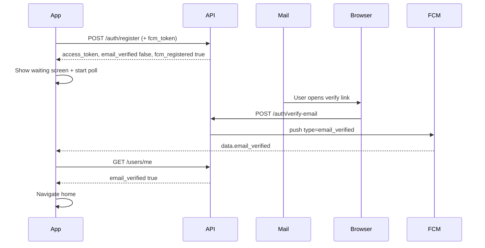
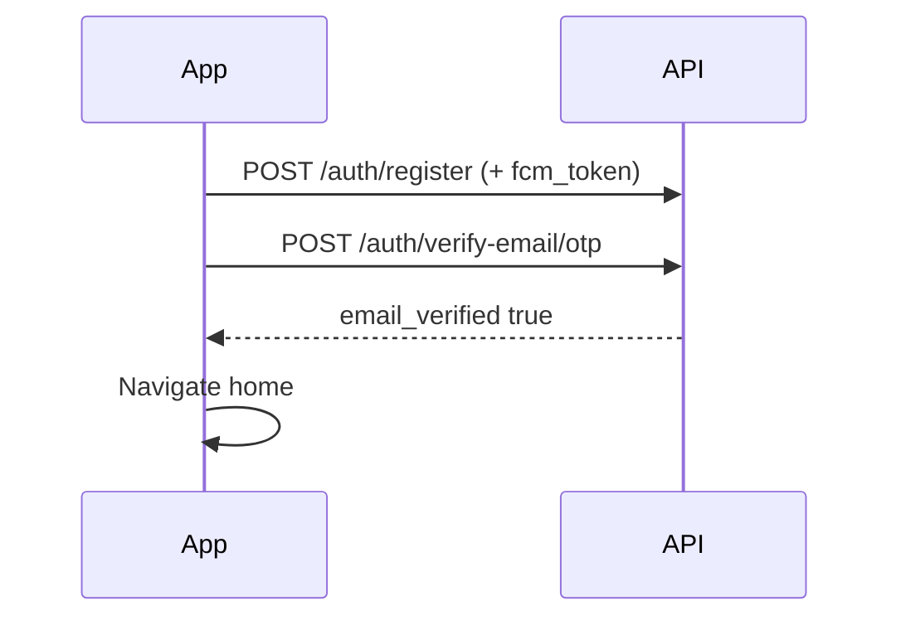

# Mobile app — email verification & auto-continue (FCM)

**Audience:** Flutter / mobile developers  
**Production API base:** `https://appworkspro.com/api/v1`  
**Response envelope:** `{ "data": { ... }, "error": null }` or `{ "data": null, "error": { "code", "message" } }`

This document is the **single source of truth** for implementing “verify email without tapping Verify in the app” — user verifies via **email link** or **OTP**, then the app continues automatically.

---

## 1. Your question: first register — FCM token on backend?

**Correct:** On the very first `POST /auth/register`, the server did **not** know the device until the app sends an FCM token.

**Fix (choose one or both — recommended: both):**

| Method | When |
|--------|------|
| **A. Same request as register** | Send `fcm_token` + `platform` in the **register JSON body** (and login). Response includes `fcm_registered: true`. |
| **B. Immediate follow-up** | Right after register succeeds, `POST /users/me/fcm-token` with the new `access_token` **before** showing the waiting screen. |

If neither A nor B runs before the user taps the email link, the server logs `[fcm] email_verified skip — no device tokens` and **no push** is sent. The app must use **polling** (section 6) as fallback.

**Mandatory app order after sign-up:**

1. Obtain Firebase FCM token on device (before or during register).
2. `POST /auth/register` **with** `fcm_token` + `platform` **OR** register then instantly `POST /users/me/fcm-token`.
3. Confirm `fcm_registered === true` or fcm-token `200`.
4. Open **Email verification waiting** screen (no “Verify account” button required for link flow).
5. User verifies (link or OTP).
6. App continues (FCM and/or poll).

---

## 2. Who needs email verification?

| Sign-up method | `user.email_verified` after auth | Waiting screen? |
|----------------|----------------------------------|-----------------|
| Email + password register | `false` | **Yes** |
| Email login (unverified user) | `false` | **Yes** |
| Google `POST /auth/google` | `true` | **No** — go to home |

Always read `email_verified` from register/login/google or `GET /users/me`.

---

## 3. API reference (exact)

### 3.1 Register

`POST /api/v1/auth/register`

```json
{
  "email": "user@example.com",
  "password": "minimum8",
  "display_name": "Ali",
  "fcm_token": "<Firebase FCM token>",
  "platform": "android",
  "device_id": "optional-stable-id",
  "app_version": "1.0.0"
}
```

Optional (if server enforces Turnstile): `captcha_token` or `turnstile_token`.

**Success `data` (relevant fields):**

| Field | Type | Meaning |
|-------|------|---------|
| `access_token` | string | Use for all authenticated calls |
| `refresh_token` | string | Store securely |
| `expires_at` | string | ISO datetime |
| `verification_message` | string | Show on waiting UI |
| `verification_email_sent` | boolean | `false` → warn user (spam / resend later) |
| `otp_length` | number | `4` |
| `expires_in_seconds` | number | OTP validity (~600) |
| `fcm_registered` | boolean | `true` if token saved on server |
| `user.email_verified` | boolean | `false` for new email sign-up |
| `user.id` | string | Mongo user id |

**If `fcm_registered` is `false`:** call `POST /users/me/fcm-token` immediately (section 3.4).

---

### 3.2 Login (returning unverified user)

`POST /api/v1/auth/login`

Same optional FCM fields as register. Response includes `fcm_registered` and `user.email_verified`.

---

### 3.3 Verify paths (server marks verified + may push FCM)

**Path 1 — Email link (browser)**  
User opens link like `https://appworkspro.com/verify-email?token=...`  
Web calls `POST /api/v1/auth/verify-email` with `{ "token": "..." }`.  
App is **not** in this request; app learns via **FCM** or **polling**.

**Path 2 — OTP inside app (sign-up)**

`POST /api/v1/auth/verify-email/otp`

```json
{ "email": "user@example.com", "otp": "1234" }
```

No `Authorization` header required.

**Success `data`:** `{ "email_verified": true, "otp_length": 4 }`  
→ Navigate to home **immediately** from API response (FCM is optional extra).

---

### 3.4 Register FCM token (standalone)

`POST /api/v1/users/me/fcm-token`  
`Authorization: Bearer <access_token>`

```json
{
  "fcm_token": "<token>",
  "platform": "android",
  "device_id": "optional",
  "app_version": "1.0.0"
}
```

Alias: `token` instead of `fcm_token`.

**Logout:** `DELETE /api/v1/users/me/fcm-token` with same token or empty body to revoke all.

---

### 3.5 Profile check (source of truth)

`GET /api/v1/users/me`  
`Authorization: Bearer <access_token>`

Use `data.email_verified` (boolean) before navigating to home after FCM.

---

## 4. FCM payload (when email link verifies)

When verification succeeds on the server (link or OTP), the backend may send:

| Key | Value |
|-----|--------|
| `data.type` | `email_verified` |
| `data.user_id` | user Mongo id |
| `data.email_verified` | `"true"` (string) |

Optional notification title/body: *Email verified* / *You can continue in the app.*

**All `data` values are strings** in FCM.

---

## 5. Flutter implementation checklist

### 5.1 Firebase setup

- Same Firebase project as server (`FIREBASE_PROJECT_ID` on backend).
- Request notification permission (iOS).
- `FirebaseMessaging.instance.getToken()` before register when possible.

### 5.2 Listeners (register early — e.g. `main()` or app shell)

```dart
// Foreground
FirebaseMessaging.onMessage.listen((RemoteMessage message) {
  _handleEmailVerifiedMessage(message);
});

// Background tap / cold start
FirebaseMessaging.onMessageOpenedApp.listen(_handleEmailVerifiedMessage);
final initial = await FirebaseMessaging.instance.getInitialMessage();
if (initial != null) _handleEmailVerifiedMessage(initial);
```

```dart
void _handleEmailVerifiedMessage(RemoteMessage message) {
  final type = message.data['type'];
  if (type != 'email_verified') return;
  // Confirm with API then navigate
  unawaited(_refreshProfileAndMaybeGoHome());
}
```

```dart
Future<void> _refreshProfileAndMaybeGoHome() async {
  final me = await api.getUsersMe(); // GET /users/me
  if (me.emailVerified == true) {
    router.goHome();
  }
}
```

### 5.3 Sign-up flow (pseudo)

```dart
final fcm = await FirebaseMessaging.instance.getToken();
final reg = await api.postRegister(
  email: email,
  password: password,
  fcmToken: fcm,
  platform: Platform.isIOS ? 'ios' : 'android',
);
await secureStorage.writeTokens(reg.accessToken, reg.refreshToken);

if (!reg.fcmRegistered && fcm != null) {
  await api.postFcmToken(fcm, platform: ...);
}

if (reg.user.emailVerified) {
  router.goHome();
} else {
  router.goEmailVerificationWaiting();
}
```

### 5.4 Waiting screen UX

- Show `verification_message`.
- Optional: 4-digit OTP field → `POST /verify-email/otp` on submit.
- **Do not** require a “Verify account” button for the **email link** path.
- Start **polling** `GET /users/me` every **3 seconds** while this screen is visible.
- On `email_verified == true` OR FCM handler → cancel poll → home.

### 5.5 OTP path

On `POST /verify-email/otp` **200** with `email_verified: true` → go home **without** waiting for FCM.

---

## 6. Polling fallback (required)

FCM can fail (no token, battery saver, permission denied). While waiting screen is open:

```
every 3s: GET /users/me
if email_verified → navigate home, stop timer
```

Stop polling when screen is disposed.

---

## 7. Sequence diagrams

### Email link (auto via FCM + poll)



### OTP in app (no FCM required)



---

## 8. Errors (verification)

| HTTP | code | Action |
|------|------|--------|
| 400 | `INVALID_OTP` | Wrong/expired OTP |
| 400 | `OTP_LOCKED` | Request new code (re-register flow / resend — product decision) |
| 400 | `INVALID_TOKEN` | Bad email link |
| 422 | `VALIDATION` | Missing email/otp |
| 429 | `RATE_LIMIT` | Back off |

---

## 9. QA test plan

1. **Register with `fcm_token` in body** → `fcm_registered: true` → open email link on another device → app on waiting screen auto-advances within ~3s (FCM or poll).
2. **Register without FCM** → open link → app only advances if **polling** enabled (no push).
3. **Register + immediate `POST /fcm-token`** → link verify → FCM received.
4. **OTP in app** → home without link.
5. **Google sign-in** → no waiting screen.
6. **Logout** → `DELETE /fcm-token` + clear local tokens.

**Server log (VPS):** `pm2 logs ai-outfit-changer | grep email_verified`

- `email_verified sent` — push attempted  
- `skip — no device tokens` — app did not register FCM in time  

---

## 10. Common mistakes

| Mistake | Result |
|---------|--------|
| Show waiting screen before `fcm-token` / register FCM fields | No push when user verifies quickly |
| Only listen to FCM, no polling | Stuck if push fails |
| Require “Verify” tap for link flow | Bad UX; link already verified on server |
| Use Google flow for email users | N/A |

---

## 11. Related docs

- `docs/MOBILE_APP_VALIDATION_AND_ERRORS.md` — all error codes  
- `docs/MOBILE_APP_API.md` — general API  

**Backend behaviour:** FCM `email_verified` is sent after successful link verify (`verifyEmailToken`) and `POST /auth/verify-email/otp`.
